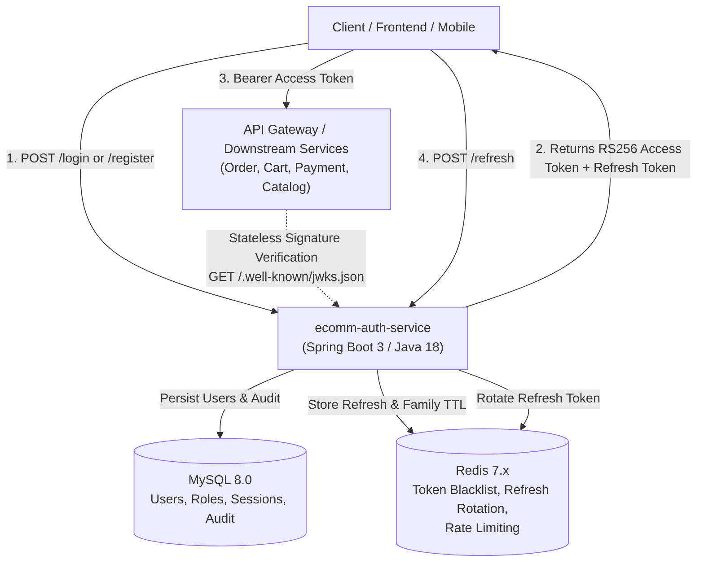

# E-Commerce API Authentication & Authorization Microservice (`ecomm-auth-service`)

Enterprise-grade authentication and authorization microservice designed for distributed e-commerce ecosystems, built with **Java 18**, **Spring Boot 3.4.x**, **Spring Security 6**, **MySQL 8.0**, and **Redis 7.x**.

---

## 🏛️ Architecture Overview



---

## 🔒 Security & Cryptographic Highlights

1. **Asymmetric RS256 JWT Access Tokens**:
   - Short-lived (15 minutes default).
   - Signed with an RSA 2048-bit private key.
   - Verified statelessly by downstream services (API Gateway, Order, Catalog, Payment) using the public key exposed via the standard **RFC 7517 JWKS endpoint** (`GET /api/v1/auth/.well-known/jwks.json`). Downstream microservices do not need to query the auth service for every request!

2. **Refresh Token Rotation & Reuse Detection (Replay Defense)**:
   - Long-lived refresh tokens (7 days default).
   - Tracked using **Token Families** in Redis and MySQL.
   - Whenever a refresh token is used, it is rotated into a brand-new token.
   - **Reuse Attack Detection**: If a previously consumed/rotated token is used again (indicating token theft), the service immediately revokes the **entire token family** and all active sessions for that user.

3. **Distributed Token Revocation & Blocklist**:
   - Access tokens can be instantly revoked before expiration (e.g. upon logout or password change) by storing the token's `jti` in Redis with a TTL equal to the token's remaining validity.
   - `JwtAuthenticationFilter` rejects any blacklisted `jti`.

4. **Brute Force & Credential Stuffing Protection**:
   - Sliding-window rate limiter powered by Redis (`RateLimiterService`).
   - Automatically locks out IP/Account after 5 consecutive failed attempts for 15 minutes.

5. **Defense-in-Depth User Personas (RBAC)**:
   - `ROLE_CUSTOMER`: Buyer persona (profile, orders, checkout).
   - `ROLE_SELLER`: Merchant persona (catalog, vendor orders).
   - `ROLE_ADMIN`: Platform administrator.
   - `ROLE_SUPPORT`: Customer service & dispute resolution.
   - Public registration allows choosing `ROLE_CUSTOMER` or `ROLE_SELLER`, strictly prohibiting self-elevation to `ROLE_ADMIN` or `ROLE_SUPPORT`.

---

## 👥 Default Test Users

> [!WARNING]
> These credentials are for **local development and demonstration testing only**. In a production deployment, ensure test seeds are removed or disabled and real secrets are injected via your cloud secret manager.

Default users are automatically initialized via `DataInitializer.java` and Flyway migration `V3__seed_default_users.sql`:

| Role | Email | Password | Assigned Authorities |
|---|---|---|---|
| **Customer (Buyer)** | `customer@ecomm.com` | `Customer123!` | `ROLE_CUSTOMER` |
| **Admin** | `admin@ecomm.com` | `Admin123!` | `ROLE_ADMIN`, `ROLE_CUSTOMER` |
| **Seller (Merchant)** | `seller@ecomm.com` | `Seller123!` | `ROLE_SELLER` |

### Quick Test via cURL

**1. Log in with Default Customer:**
```bash
curl -X POST http://localhost:8081/api/v1/auth/login \
  -H "Content-Type: application/json" \
  -d '{
    "email": "customer@ecomm.com",
    "password": "Customer123!"
  }'
```

**2. Access Authenticated Identity claims using the returned Access Token:**
```bash
curl -X GET http://localhost:8081/api/v1/auth/me \
  -H "Authorization: Bearer <YOUR_ACCESS_TOKEN>"
```

---

## 📖 Swagger / OpenAPI 3 Documentation

Interactive OpenAPI 3 documentation and Swagger UI are integrated into the microservice:

- **Swagger UI Interactive Console**: [http://localhost:8081/swagger-ui.html](http://localhost:8081/swagger-ui.html)
- **OpenAPI 3 JSON Spec**: [http://localhost:8081/v3/api-docs](http://localhost:8081/v3/api-docs)

### Testing Authenticated Endpoints via Swagger UI
1. Open the **Swagger UI** in your browser.
2. Call `POST /api/v1/auth/login` with your credentials (`customer@ecomm.com` / `Customer123!`).
3. Copy the returned `accessToken`.
4. Click the **Authorize 🔓** button in the top-right corner of Swagger UI.
5. Paste your access token into the value field and click **Authorize**.
6. All protected endpoints (such as `GET /api/v1/auth/me`, `POST /api/v1/auth/logout`, `POST /api/v1/auth/change-password`) can now be tested directly in the browser!

---

## 📡 REST API Endpoints

### Public Endpoints
| Method | Endpoint | Description |
|---|---|---|
| `POST` | `/api/v1/auth/register` | Register new Customer or Merchant |
| `POST` | `/api/v1/auth/login` | Authenticate with email/password; returns access & refresh tokens |
| `POST` | `/api/v1/auth/refresh` | Rotate refresh token and obtain new access token |
| `POST` | `/api/v1/auth/forgot-password` | Request password reset token |
| `POST` | `/api/v1/auth/reset-password` | Complete password reset using token |
| `GET` | `/api/v1/auth/.well-known/jwks.json` | RFC 7517 JSON Web Key Set for downstream signature validation |
| `GET` | `/api/v1/auth/public-key` | PEM-encoded RSA Public Key |
| `GET` | `/actuator/health` | Service health status |

### Protected Endpoints (Bearer JWT Required)
| Method | Endpoint | Authorization | Description |
|---|---|---|---|
| `GET` | `/api/v1/auth/me` | Authenticated | Get authenticated user identity & roles |
| `POST` | `/api/v1/auth/logout` | Authenticated | Revoke refresh token and blacklist access token |
| `POST` | `/api/v1/auth/change-password` | Authenticated | Change password & invalidate all user sessions |

---

## 🚀 Getting Started

### Prerequisites
- **Java 18** (or newer JDK with Java 18 target)
- **Maven 3.9+**
- **Docker / Podman** and **Docker Compose**

### Running with Docker Compose
To start the auth service, MySQL, and Redis together:
```bash
docker compose up -d --build
```

### Running Locally (Bare Metal)
1. Start MySQL and Redis:
```bash
docker run -d --name mysql -p 3306:3306 -e MYSQL_ROOT_PASSWORD=rootpassword -e MYSQL_DATABASE=ecomm_auth mysql:8.0
docker run -d --name redis -p 6379:6379 redis:7.2-alpine
```

2. Build and run the service:
```bash
mvn clean package -DskipTests
java -jar target/auth-service-1.0.0-SNAPSHOT.jar
```

---

## 🧪 Testing

Execute unit and integration tests:
```bash
mvn test
```
The test suite includes:
- **`JwtTokenProviderTest`**: RS256 token generation, signature validation, tampering detection, RFC 7517 JWKS structure.
- **`AuthServiceTest`**: Customer registration, duplicate email handling, login authentication, brute-force rate limiter triggers.
- **`RefreshTokenServiceTest`**: Token rotation, family tracking, replay attack detection & family revocation.
- **`AuthControllerTest`**: MockMvc controller validation and error handling.

---

## ⚙️ Environment Configuration

| Variable | Default | Description |
|---|---|---|
| `DB_HOST` | `localhost` | MySQL database host |
| `DB_PORT` | `3306` | MySQL port |
| `DB_NAME` | `ecomm_auth` | Database name |
| `DB_USER` | `root` | Database username |
| `DB_PASSWORD` | `rootpassword` | Database password |
| `REDIS_HOST` | `localhost` | Redis host |
| `REDIS_PORT` | `6379` | Redis port |
| `SECURITY_JWT_ACCESS_TOKEN_EXPIRATION_MINUTES` | `15` | Access token lifespan in minutes |
| `SECURITY_JWT_REFRESH_TOKEN_EXPIRATION_DAYS` | `7` | Refresh token lifespan in days |
| `JWT_RSA_PRIVATE_KEY` | *(empty)* | Optional PEM RSA Private Key (auto-generated if omitted) |
| `JWT_RSA_PUBLIC_KEY` | *(empty)* | Optional PEM RSA Public Key |

